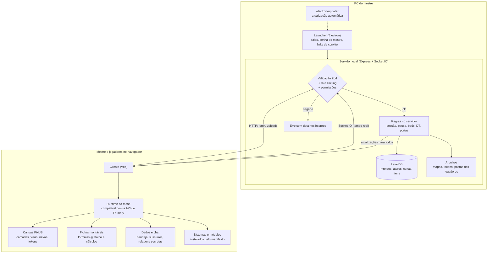

# MimicDice VTT

[](https://github.com/KairoHenrique/MimicDice-VTT/releases/latest)   

> Veja o que mudou em cada versão em [PATCHNOTES.md](PATCHNOTES.md).

Mesa virtual (VTT) para jogar RPG com os amigos. Você hospeda a mesa no seu próprio computador, envia o link de convite e os jogadores entram pelo navegador, sem precisar de assinatura nem de servidor na nuvem.

O MimicDice inclui uma camada de compatibilidade com a API do Foundry VTT, então dá para instalar sistemas e módulos feitos para ele.

## Download

Baixe o instalador para Windows (`MimicDice-VTT-<versão>-instalador.exe`) na [última versão](https://github.com/KairoHenrique/MimicDice-VTT/releases/latest). O app avisa e instala sozinho as versões novas. Os jogadores não instalam nada: só abrem o link de convite no navegador.

## Funcionalidades

- **Português, inglês e espanhol:** o app abre no idioma do computador (inglês para qualquer outro idioma) e dá para trocar na tela de entrada ou nas Configurações.
- **App desktop para o mestre (Windows):** instalador em português, inglês e espanhol que remove os arquivos da versão anterior antes de atualizar, deixa escolher a pasta e se quer o atalho na Área de Trabalho; inicia o servidor local, mostra os links de convite da rede (Wi-Fi/LAN e Radmin VPN), ocultos até você clicar no olho, e libera a porta no Firewall do Windows com um clique.
- **Sessão da mesa:** o mestre inicia e fecha a sessão; fechada, os jogadores ficam congelados na última visão (ficha e dados continuam). Fecha sozinha após 1 hora parada.
- **Controlar boneco:** o mestre vê e joga exatamente como um personagem, e escolhe quais jogadores controlam cada boneco ou NPC.
- **Jogadores pelo navegador:** quem foi convidado só precisa abrir o link, sem instalar nada.
- **Mundos:** crie e alterne entre campanhas, cada uma com seus próprios dados.
- **Sistemas e módulos:** instale pelo link do manifesto, com download e extração em ambiente controlado.
- **Mesa:** canvas com mapas e tokens (PixiJS), rolagem de dados, fichas, chat e sidebar de documentos.
- **Movimento com caminho:** segure Ctrl ao arrastar um token para ver a distância e confirmar antes de andar. Todos veem o token andando em tempo real, e WASD move um quadrado por vez.
- **Desenhos:** jogadores desenham numa camada acima do mapa; o mestre apaga e trava qualquer desenho.
- **Tutorial:** botão ? no topo e Shift + clique em qualquer opção para ver a ajuda dela.
- **Portas com chave:** portas animadas, que podem ser trancadas ou exigir um item carregado pelo personagem.
- **Ferramentas do mestre:** modo jogo e modo edição, pausar a cena, objetos travados no lugar e "Mostrar minha visão" (mesma cena, posição e zoom para todos).
- **Puxar jogadores:** botão direito num ponto vazio do mapa para trazer o token de todos os jogadores, ou de um só, até ali.
- **Limite de visão:** o mestre define até quantos metros os jogadores enxergam a partir dos seus tokens.
- **Tradução automática:** textos em inglês de sistemas e módulos aparecem em português, sem internet.
- **Pings no mapa:** aperte P para destacar um ponto para todos; o mestre, com Shift + P, leva a câmera de todos até lá.
- **Efeitos do mestre:** crie efeitos (envenenado, tonto, cego...) com ícone e cor, que tiram vida por turno, fazem agir por último ou limitam a visão, e aplique por quantos turnos quiser.
- **Aparências:** até 5 imagens por personagem, trocadas pelo dono ou pelo mestre.
- **Mapa em camadas:** grupos Mapa (chão), Props, Personagens e Notas, com várias camadas em Mapa e Props que o mestre reordena, esconde, trava, deixa transparentes e mescla, como num editor de imagem.
- **Rastreador de iniciativa:** aba Combate com turno, de quem é a vez (também num aviso no topo, para todos) e quanto o personagem da vez já andou. O mestre reordena arrastando ou com as setas e manda alguém para o fim da fila (ficou tonto, atrasou a ação).
- **Painel de status:** janela arrastável com vida, PE e sanidade. O mestre escolhe quem aparece (jogadores, combate, cena ou um por um); cada jogador vê só os próprios personagens.
- **Controle do mestre:** aba nas Configurações para escolher quais barras existem (e com quais nomes da ficha), o que os jogadores veem e quem pode arrastar tokens de outros.
- **Barra lateral recolhível:** esconda chat, combate e atores para ver o mapa inteiro.
- **Chat com sussurros:** mensagens públicas ou privadas para um jogador, com o mestre vendo todas as conversas, além de rolagens secretas.
- **Configurações e atalhos:** preferências por usuário e teclas trocáveis, salvas na conta.
- **Salas no launcher:** crie, abra, entre e exclua suas mesas direto pelo app desktop.
- **Usuários e permissões:** senha do mestre por sala (opcional), "lembrar minha senha", banimento de jogadores, papéis por jogador e presença em tempo real via Socket.IO.
- **Fichas montáveis:** o mestre monta o modelo de ficha arrastando componentes (números, barras, tabelas, perícias, cálculos e rolagens), seleciona vários de uma vez e escreve fórmulas com atalhos `@`.
- **Pastas e notas dos jogadores:** cada jogador tem sua pasta para imagens, PDFs e notas de texto que ele escreve e edita ali mesmo.
- **Quem está movendo:** enquanto alguém arrasta um token, todos veem o nome dessa pessoa embaixo dele.
- **Montar o mapa arrastando:** painel com as imagens enviadas; arraste para o mapa e monte como um quebra-cabeça, com encaixe em 1/4 de quadrado. Tiles redimensionáveis pelo canto e GIFs, webm e mp4 animados.
- **Desfazer e borracha:** Ctrl+Z desfaz movimentos, edições e exclusões; Delete apaga os selecionados, e a borracha apaga cada objeto clicado.
- **Grupos de tokens:** tokens agrupados andam juntos mantendo a distância.
- **Memória da névoa:** fora da visão, o jogador vê tiles e notas como estavam da última vez que os viu.
- **Baús, percepção e armadilhas:** baús com imagem, capacidade e itens com DT de percepção, conferidos pelo servidor; objetos e notas escondidos por DT, com a percepção dos jogadores anotada por cena; armadilhas invisíveis que disparam ao pisar e aplicam efeitos. O mestre revela qualquer segredo quando quiser.
- **Itens no mapa:** arraste itens para tokens, fichas ou para o chão; o mestre vê onde está cada cópia.
- **Bandeja de dados:** monte a rolagem clicando nos dados e escolha somar, pegar o maior ou pegar o menor. A animação mostra os bônus e o total.
- **Efeitos com dados:** dano ou cura por turno e duração aceitam dados (1d6+2, 1d4 turnos), e efeitos positivos somam bônus nas rolagens da ficha.
- **Ficha padrão "Agente (planilha)":** classes, atributos, perícias, PV e PE calculados por fórmula, armaduras, armas e inventário, pronta para usar.

## Fórmulas da ficha

Os componentes da ficha usam fórmulas para rolar dados e calcular valores. O mesmo guia está no tutorial do app (botão **?** > **Fórmulas da ficha**).

| O que | Como escrever | Exemplo |
| --- | --- | --- |
| Usar outro componente | `@atalho` (o "Atalho @" definido no componente) | `1d20 + @forca` |
| Dados | `NdX` rola N dados de X lados | `2d6 + 3` |
| Quantidade de dados vinda da ficha | `(@atalho)dX` | `(@agilidade)d20` |
| Manter os maiores / menores | `kh` / `kl` (com quantidade opcional) | `4d6kh3`, `2d20kl` |
| Descartar o menor / maior | `dl` / `dh` | `4d6dl1` |
| Valor dentro de outro | `@atalho.campo` | `@recursos.vida.max` |
| Coluna da linha da tabela | `@linha.<coluna>` | `1d20 + @linha.bonus` |
| Pontos da perícia clicada | `@valor` | `(@valor)d20`, `1d20 + @valor` |
| Uma perícia em outro componente | `@<atalho da lista>.<chave da perícia>` | `@pericias.luta` |

**Resultado da rolagem.** Os componentes que rolam dados têm a opção *Somar todos os dados*, *Só o maior dado* ou *Só o menor dado*. Com `(@agilidade)d20` e *Só o maior dado*, o personagem rola um d20 por ponto de Agilidade e fica com o melhor.

**Cálculo.** O componente *Cálculo* mostra um número sem rolar dados, e outros componentes podem usar o atalho dele. Funções disponíveis: `floor` (arredonda para baixo), `ceil` (para cima), `round`, `abs`, `min`, `max`, `clamp(valor, mínimo, máximo)`, `sqrt` e `pow`.

```text
floor((@forca - 10) / 2)
max(1, @vigor * 2)
clamp(@pv_atual, 0, @pv_max)
```

**Lista de perícias.** O mestre escreve os nomes (um por linha), escolhe de 1 a 4 colunas, se o valor é número ou bolinhas, os pontos máximos (o cabeçalho fica vermelho quando passa) e uma fórmula com `@valor`. Cada nome vira um botão de rolar.

**Máximos calculados.** O máximo de uma barra (ex.: `@pv_maximo`), a quantidade de bolinhas (ex.: `@nivel`) e os pontos máximos das perícias (ex.: `(@intelecto + 6) * 5`) aceitam um cálculo e mudam sozinhos quando os valores da ficha mudam. Barra cheia continua cheia quando o máximo sobe.

**Condições.** `if(condição, se sim, se não)` com `eq`, `neq`, `gt`, `gte`, `lt`, `lte`, `and`, `or` e `not`; caixas valem 1 ou 0, `@chave_n` é a posição da opção escolhida numa lista e `choose(posição, a, b, c)` escolhe um valor por ela.

Se a fórmula estiver errada, a rolagem não acontece e o app avisa: confira os parênteses e se o atalho existe na ficha.

## Segurança

- Senhas com hash Argon2 e sessões com expiração configurável.
- "Lembrar minha senha" sem guardar a senha: token aleatório em cookie httpOnly, apenas o hash no disco, rotacionado a cada uso.
- Rate limiting no login, nos uploads, nas instalações de pacotes e nos eventos de socket.
- Validação de todas as entradas com Zod, sanitização de HTML e cabeçalhos de segurança com Helmet.
- Extração de ZIP protegida contra path traversal, com tipos de arquivo de upload restritos.
- Banimento por nome e por impressão HMAC do endereço (nunca o endereço em texto); o PC que hospeda nunca é banido.
- Sessão fechada, mapa travado e pausa são aplicados no servidor, não só na tela.
- O app desktop isola o renderer e restringe as permissões do Electron e os canais IPC.

## Como funciona



## Estrutura do projeto

Monorepo com npm workspaces:

| Pasta | Conteúdo |
| --- | --- |
| `apps/server` | Servidor HTTP + Socket.IO (Express, LevelDB) |
| `apps/client` | Interface web da mesa (Vite) |
| `apps/desktop` | App Electron que hospeda o servidor e o launcher |
| `packages/api` | Runtime da mesa e camada de compatibilidade com a API do Foundry |
| `packages/common` | Lógica compartilhada entre cliente e servidor |
| `packages/protocol` | Contratos e schemas de comunicação (Zod) |
| `scripts` | Ferramentas de desenvolvimento |

## Como rodar

Requer [Node.js](https://nodejs.org/) 24 ou superior.

```bash
npm install
```

### Desenvolvimento

Em dois terminais:

```bash
npm run dev:server   # servidor em http://localhost:30000
npm run dev:client   # cliente com hot reload em http://localhost:5173
```

### Produção (navegador)

```bash
npm run build
npm start
```

Acesse `http://localhost:30000`.

### App desktop

```bash
npm run build                          # compila o cliente
npm run start -w @tabbletop/desktop    # abre o app em modo de desenvolvimento
npm run package -w @tabbletop/desktop  # gera o instalador em apps/desktop/release
```

### Testes e checagem de tipos

```bash
npm test
npm run typecheck
npm run i18n:check
```

### Traduções

Os textos são escritos em português direto no código; `packages/i18n/catalogs/en.json` e `es.json` guardam as traduções. Depois de criar ou mudar textos da interface:

1. `npm run i18n:missing` gera `i18n-missing.json` com o que falta traduzir;
2. traduza num arquivo `{ "texto": { "en": "...", "es": "..." } }` e rode `npm run i18n:merge -- arquivo.json`;
3. `npm run i18n:prune` remove traduções de textos que não existem mais.

## Configuração

O servidor lê estas variáveis de ambiente (todas opcionais):

| Variável | Padrão | Descrição |
| --- | --- | --- |
| `TABBLETOP_PORT` | `30000` | Porta do servidor |
| `TABBLETOP_HOST` | `0.0.0.0` | Interface de rede |
| `TABBLETOP_DATA_PATH` | `./data` | Pasta de mundos, sistemas, módulos e configurações |
| `TABBLETOP_CLIENT_DIST` | `./apps/client/dist` | Build do cliente servido pelo servidor |
| `TABBLETOP_SESSION_HOURS` | `12` | Duração da sessão de login (1 a 168 horas) |
| `TABBLETOP_LOG_LEVEL` | — | Nível de log do servidor |
| `TABBLETOP_LAUNCHER_TOKEN` | — | Chave interna do launcher (o app desktop gera uma aleatória a cada execução; não defina manualmente) |

## Jogando com amigos fora da sua rede

O servidor roda no seu computador, então os jogadores precisam alcançá-lo pela rede. As opções mais simples são:

- **Mesma rede (Wi-Fi/LAN):** use o link de convite mostrado no launcher.
- **Radmin VPN** (ou similar): todos entram na mesma rede virtual e usam o link do Radmin mostrado no launcher.
- **Redirecionamento de porta** no roteador para a porta `30000`.

Se o Windows bloquear a conexão, use o botão **Liberar porta no firewall** no launcher.

## Desenvolvimento

<table>
  <tr>
    <td align="center" width="50%">
      <a href="https://github.com/KairoHenrique">
        
      </a>
      <br>
      <b>Kairo Henrique<br>Ferreira Martins</b>
      <br>
      Desenvolvedor
      <br>
      <a href="https://github.com/KairoHenrique">github.com/KairoHenrique</a>
    </td>
    <td align="center" width="50%">
      <a href="https://github.com/L30NRd">
        
      </a>
      <br>
      <b>Leonardo Coimbra</b>
      <br>
      Ajuda no desenvolvimento
      <br>
      <a href="https://github.com/L30NRd">github.com/L30NRd</a>
    </td>
  </tr>
</table>

## Licença

Distribuído sob a licença [MIT](LICENSE).

Foundry Virtual Tabletop é marca da Foundry Gaming LLC. O MimicDice VTT é um projeto independente, sem afiliação nem endosso da Foundry Gaming.
